# 🧪 Awesome QA Account & Subscription Management 💳

  

  
  
  
  
  
  

> 🎯 A definitive, SEO-optimized curated index of **QA Account and Subscription Management** solutions — spanning SaaS commercial test clouds, device concurrency slots, billing admin dashboards, seat licensing, and open-source usage metering and recurring billing engines.
> 
> 🌟 *Star this repository if you find it helpful for architecting or procuring software testing infrastructure!* 🌟

---

## 📑 Table of Contents
- [🌐 Sector Overview & Market Dynamics](#-sector-overview--market-dynamics)
- [🏢 SaaS & Hosted Commercial Platforms](#-saas--hosted-commercial-platforms)
  - [Detailed SaaS Profiles](#-detailed-saas-profiles)
- [💻 Open-Source Billing & Subscription Engines](#-open-source-billing--subscription-engines)
  - [Detailed Open-Source Profiles](#-detailed-open-source-profiles)
- [📊 Feature & Governance Comparison](#-feature--governance-comparison)
- [📈 Star History](#-star-history)
- [💖 Support & Sponsorship](#-support--sponsorship)
- [🤝 Contributing](#-contributing)
- [📄 License](#-license)

---

## 🌐 Sector Overview & Market Dynamics

The global software testing and continuous QA cloud infrastructure market is estimated at **$45 Billion to $50 Billion**, expanding steadily at a compound annual growth rate (CAGR) of **~15%** driven by AI test automation and cloud device grid scaling. The sector exhibits a **moderately fragmented yet top-heavy concentration**: hyperscalers and top-tier vendors (AWS, BrowserStack, Sauce Labs, and SmartBear) control dominant enterprise market share and concurrency capacity, while specialized testing clouds and next-generation AI automation engines compete actively for mid-market and startup accounts.

---

## 🏢 SaaS & Hosted Commercial Platforms

Commercial QA platforms provide cross-browser testing clouds, mobile device farms, and concurrency execution slots. The table below compares commercial platforms sorted descending by company scale (**Company Scale / Valuation / Revenue**):

| Platform / Vendor | Company Scale (Valuation / Revenue) | Starting Tier Pricing | Free Tier / Trial Limit | Concurrency / Pricing Basis | Management & Cancellation |
| :--- | :--- | :--- | :--- | :--- | :--- |
| **[AWS Device Farm](https://aws.amazon.com/device-farm/)** | **$2+ Trillion** Market Cap (AWS: ~$105B+ Annual Revenue Run Rate) | **$0.17 / device-minute** (Pay-as-you-go) or **$250 / slot / month** (Unmetered automated testing slot) | **1,000 device minutes** one-time free trial | Per device slot / per device minute | AWS Console & CLI (`purchase-offering`, `get-account-settings`); cancel slot renewals anytime via AWS Management Console |
| **[BrowserStack](https://www.browserstack.com/)** | **$4 Billion** Valuation (~$200M–$250M ARR) | **$39 / user / month** (Desktop Live, billed annually) or **$199 / parallel / month** (Automate) | **Limited free trial**: 100 mins automated mobile, 60 mins manual Live, 5,000 Percy screenshots (no permanent free tier) | Per user seat + concurrent parallel test lanes | Restricted to **Organization Owner**; self-serve billing portal with cycle-end cancellation semantics |
| **[BitBar (SmartBear)](https://smartbear.com/product/bitbar/)** | **$1.8 Billion – $2.0 Billion** Valuation (~$150M+ Revenue) | **$47 / license / month** (Live Testing, billed annually) or **$209 / parallel / month** (Unlimited) | **14-day free trial** (limited devices, 1 automated run/hr, 4-minute live sessions, no credit card required) | Per license seat + concurrent test runs | Self-serve dashboard for personal/team plans; instant **Unsubscribe** button; Team plan modifications require admin changes |
| **[Sauce Labs](https://saucelabs.com/)** | **$613 Million** Valuation (~$90M–$100M ARR) | **$39 / month** (Live Testing, billed annually) or **$149 / month** (Virtual Device Cloud) | **28-day free trial** (60 automated & live test minutes, 3 parallel virtual machines, AI authoring queries) | Concurrent parallel execution lanes & device target types | Self-serve via **Account > Subscription and Billing**; immediate prorated upgrades; downgrades & cancellations take effect at cycle renewal |
| **[LambdaTest](https://www.lambdatest.com/)** | **$400 Million** Valuation (~$35M–$45M ARR) | **$15 / user / month** (Live Interactive, billed annually) or **$99 / parallel / month** (Web Automation) | **Freemium free-for-ever tier**: 60 mins/month manual testing, 1 parallel test session, 10 responsive test runs/month | Concurrent parallel sessions + user seats | Self-serve plan switching with monthly/annual toggle; one-click **Cancel Subscription** flow with reactivation/resume option |
| **[Kobiton](https://kobiton.com/)** | **$25 Million – $27 Million** Annual Revenue ($40M+ VC Funding) | **$83 / month** (Startup Plan, billed annually; includes 500 cloud device minutes) | **30-day free trial** with restricted device minute test pool (no permanent free tier) | Real-device minute pools + dedicated device slots | Organization Owner gated; switch plans between monthly/annual; cancellations finalize at end of current billing cycle |
| **[TestGrid](https://testgrid.io/)** | **$5 Million – $8 Million** Annual Revenue (Seed/Pre-Series A) | **$199 / seat / month** (Starter Plan with 5,000 AI test creation tokens) | **Request-based free trial** (1 to 2 weeks guided POC with solutions engineer; no permanent free tier) | Per seat license + bundled AI token pool | Upgrades take effect immediately; downgrades and cancellations take effect upon contract renewal |

---

### 🔍 Detailed SaaS Profiles

#### 🔹 BrowserStack Account Management
* **Overview:** Enterprise testing cloud spanning 3,000+ real mobile devices and desktop browsers.
* **Subscription Mechanics:** Subscription and invoice management is strictly restricted to the **Organization Owner** role. Billing details can be updated via **Billing & Invoices**. Upgrades apply immediately; cancellations stop auto-renewal at the end of the billing cycle.
* **Pricing & Free Limits:** Starts at **$39/user/month** (annual Live). Free trial includes 60 live minutes, 100 mobile automation minutes, and 5,000 visual comparison screenshots.

#### 🔹 Sauce Labs Subscription & Billing
* **Overview:** Continuous automated testing platform providing real devices, emulators, simulators, and error reporting.
* **Subscription Mechanics:** Self-serve tier changes via **Account > Subscription and Billing**. Upgrades take effect immediately with proration, and downgrades apply at renewal.
* **Pricing & Free Limits:** Starts at **$39/month** (Live) and **$149/month** (Virtual Devices). Free trial spans **28 days** with 60 testing minutes and 3 parallel VMs.

#### 🔹 LambdaTest Subscriptions
* **Overview:** High-velocity test execution grid with HyperExecute and AI-driven Kane AI test generation.
* **Subscription Mechanics:** Dynamic self-serve portal under **Subscriptions & Billings**. Supports granular parallel quantity dropdowns, monthly/yearly billing switches, and instant plan pause/resume features.
* **Pricing & Free Limits:** Paid tiers start at **$15/user/month** (annual). Permanent **Free Forever plan** offers 60 minutes/month live testing and 1 concurrency slot.

#### 🔹 Kobiton Subscription Management
* **Overview:** Mobile-first test platform specializing in real devices, automated script generation, and private cloud appliance integration.
* **Subscription Mechanics:** Org-Owner-gated subscription management via **Account > Subscription** with scheduled end-of-period cancellation semantics.
* **Pricing & Free Limits:** Paid tiers start at **$83/month** (annual Startup tier with 500 device minutes). Free trial provides **30 days** of device access.

#### 🔹 BitBar Subscriptions
* **Overview:** SmartBear's enterprise device cloud supporting unlimited test concurrency models across real Android and iOS hardware.
* **Subscription Mechanics:** Self-serve dashboard under **My Subscriptions** with clear usage consumption metrics and a one-click unsubscribe workflow.
* **Pricing & Free Limits:** Paid tiers start at **$47/license/month** (billed annually). Free trial includes a **14-day evaluation** without credit card requirement.

#### 🔹 TestGrid Pricing & Plans
* **Overview:** AI-native test automation ecosystem bundling real-device infrastructure with token-based AI authoring and test repair.
* **Subscription Mechanics:** Seat-based subscription where test generation agent access is bundled into the base fee. Enterprise deployments support private cloud and on-premise appliances.
* **Pricing & Free Limits:** Starts at **$199/seat/month** (Starter Plan). Includes a **14-day guided enterprise trial / POC**.

#### 🔹 AWS Device Farm Slots
* **Overview:** Amazon Web Services managed device farm offering pay-as-you-go automated testing and interactive browser sessions.
* **Subscription Mechanics:** Slot-based unmetered concurrency or consumption-based device minutes managed via AWS CloudFormation, AWS CLI, or AWS Console.
* **Pricing & Free Limits:** Metered at **$0.17/device-minute** or **$250/slot/month**. First **1,000 device minutes are 100% free**.

---

## 💻 Open-Source Billing & Subscription Engines

While specialized open-source platforms built *exclusively* for QA device clouds do not exist, modern engineering teams adapt open-source subscription management, meter-based billing, and invoicing engines to govern internal QA infrastructure, allocate department seats, track test runner minutes, and manage billing.

The table below lists open-source projects sorted descending by **GitHub Stars**:

| Project | GitHub Star Badge | Stars | Stack | License | Core Capabilities for QA Infrastructure |
| :--- | :--- | :--- | :--- | :--- | :--- |
| **[Lago](https://github.com/getlago/lago)** |  | **10,800+** | Go / Ruby on Rails | AGPL-3.0 | Real-time usage event metering, credit wallets, test runner consumption tracking, and flexible recurring subscription tiers |
| **[Wallos](https://github.com/ellite/Wallos)** |  | **8,800+** | PHP / SQLite | MIT | Self-hosted subscription tracker for logging recurring SaaS seats, license renewal alerts, category spend, and multi-currency cost breakdowns |
| **[Crater](https://github.com/crater-invoice/crater)** |  | **8,300+** | PHP / Laravel / Vue.js | AGPL-3.0 | Self-hosted invoicing, seat billing, client payment portals, and automated recurring billing schedules |
| **[Flexprice](https://github.com/flexprice/flexprice)** |  | **6,800+** | Go / PostgreSQL / ClickHouse | AGPL-3.0 | High-throughput usage-based billing infrastructure, VPC-deployable plan versioning, wallet balances, and developer entitlement checks |
| **[Kill Bill](https://github.com/killbill/killbill)** |  | **5,800+** | Java / MySQL / PostgreSQL | Apache-2.0 | Enterprise-grade subscription billing and payments engine, Kaui admin dashboard, multi-tenant billing, and complex catalog governance |
| **[OpenMeter](https://github.com/openmeterio/openmeter)** |  | **2,400+** | Go / ClickHouse / Kafka | Apache-2.0 | Cloud-native real-time event streaming and meter collection for tracking API requests, device minutes, and test runner executions |
| **[Meteroid](https://github.com/meteroid-oss/meteroid)** |  | **1,300+** | TypeScript / Node.js | MIT / Commercial | Hybrid subscription billing, deduplicated usage metering, credit ledgers, and prorated mid-cycle tier changes |
| **[stapel-billing](https://github.com/usestapel/stapel-billing)** |  | **Featured** | Python / Django | MIT | Modular Django billing package providing per-user credit wallets, Stripe customer portal checkout, and entitlement verification |

---

### 🔍 Detailed Open-Source Profiles

#### 🔹 [Lago](https://github.com/getlago/lago) 
* **Architecture:** Go / Ruby on Rails / PostgreSQL
* **QA Use-Case:** Perfect for tracking API and test execution events at scale. Ideal for internal developer platforms charging internal teams for CI/CD pipeline runs and device farm minutes.
* **Highlights:** Native Stripe/Adyen sync, developer-first REST API, customer portal, and dynamic credit wallets.

#### 🔹 [Wallos](https://github.com/ellite/Wallos) 
* **Architecture:** PHP / SQLite / Docker
* **QA Use-Case:** Enables QA managers and lead engineers to maintain an accurate internal register of team subscriptions (Sauce Labs, BrowserStack, TestRail, Jira), tracking upcoming renewal dates and monthly spend.
* **Highlights:** Self-hosted, lightweight single-container setup, dark mode UI, and notification webhooks.

#### 🔹 [Crater](https://github.com/crater-invoice/crater) 
* **Architecture:** PHP / Laravel / Vue.js / Mobile Apps
* **QA Use-Case:** Facilitates internal chargeback or external client billing for QA testing agencies providing dedicated testing devices and QA-as-a-Service subscriptions.
* **Highlights:** Detailed invoice design, recurring payments, payment gateways, and dedicated iOS/Android apps.

#### 🔹 [Flexprice](https://github.com/flexprice/flexprice) 
* **Architecture:** Go / ClickHouse / PostgreSQL
* **QA Use-Case:** Handles heavy event streaming loads when measuring millions of automated UI test actions, API assertions, and parallel test thread minutes.
* **Highlights:** Microsecond ingestion latency, custom entitlement guards, and tenant credit management.

#### 🔹 [Kill Bill](https://github.com/killbill/killbill) 
* **Architecture:** Java / OSGi / MySQL / PostgreSQL
* **QA Use-Case:** The battle-tested industry standard for enterprise organizations requiring a fully self-hosted billing backend to orchestrate internal multi-tenant test platform subscriptions.
* **Highlights:** Kaui administrative UI, battle-tested dunning and invoice adjustments, plugin ecosystem.

#### 🔹 [OpenMeter](https://github.com/openmeterio/openmeter) 
* **Architecture:** Go / Apache Kafka / ClickHouse
* **QA Use-Case:** High-throughput streaming meter collection engine that ingests test execution telemetry directly from test harnesses (Playwright, Cypress, Selenium) for consumption billing.
* **Highlights:** Sub-millisecond latency, Kafka event ingestion, and OpenTelemetry standards compatibility.

#### 🔹 [Meteroid](https://github.com/meteroid-oss/meteroid) 
* **Architecture:** TypeScript / Node.js / PostgreSQL
* **QA Use-Case:** Adaptable billing engine for teams combining recurring seat fees with usage-based cloud device minutes and test data storage fees.
* **Highlights:** Deduplicated usage recording, prepaid voucher balances, and automated proration math.

#### 🔹 [stapel-billing](https://github.com/usestapel/stapel-billing) 
* **Architecture:** Python / Django / Stripe
* **QA Use-Case:** Drop-in Django module for Python developers building custom QA dashboards that require customer wallet management and Stripe subscription sync.
* **Highlights:** Idempotent webhooks, plug-and-play Stripe checkout, and simple entitlement enforcement.

---

## 📊 Feature & Governance Comparison

| Solution | Deployment Model | License | Primary Focus | Best Fit For |
| :--- | :--- | :--- | :--- | :--- |
| **AWS Device Farm** | Cloud SaaS | Proprietary | Real device testing & slot concurrency | AWS ecosystems requiring programmatic API execution |
| **BrowserStack** | Cloud SaaS | Proprietary | Cross-browser & mobile device cloud | Enterprises requiring strict owner-gated billing governance |
| **BitBar** | Cloud SaaS / Private | Proprietary | Unlimited device concurrency grid | Teams needing high-concurrency real-hardware test runs |
| **Sauce Labs** | Cloud SaaS | Proprietary | Cross-browser testing & error analytics | Teams wanting automated proration and instant self-serve tier changes |
| **LambdaTest** | Cloud SaaS | Proprietary | HyperExecute & AI test orchestration | Teams wanting a permanent free tier and flexible parallel toggles |
| **Kobiton** | Cloud SaaS / Hybrid | Proprietary | Mobile real-device cloud & script generation | Dedicated mobile QA teams needing device appliances |
| **TestGrid** | Cloud / On-Prem | Proprietary | AI test generation & all-in-one test suite | Organizations wanting bundled AI test generation tokens |
| **Lago** | Self-Hosted / Cloud | AGPL-3.0 | Real-time usage-based billing & metering | Engineering platforms metering automated runner minutes |
| **Wallos** | Self-Hosted | MIT | Personal & team subscription tracking | QA engineering leads tracking testing tool subscription renewals |
| **Crater** | Self-Hosted | AGPL-3.0 | Client invoicing & recurring payments | QA agencies and consultancies billing clients for testing seats |
| **Flexprice** | Self-Hosted / VPC | AGPL-3.0 | High-throughput usage billing infrastructure | High-frequency automated testing pipelines needing low latency |
| **Kill Bill** | Self-Hosted | Apache-2.0 | Enterprise multi-tenant billing engine | Complex enterprise billing with custom accounting plugins |
| **OpenMeter** | Self-Hosted / Cloud | Apache-2.0 | Real-time event ingestion & meter collection | High-scale test runner telemetry and consumption quotas |
| **Meteroid** | Self-Hosted | MIT / Commercial | Hybrid subscription & usage billing | Teams requiring seat + usage hybrid billing models |
| **stapel-billing** | Self-Hosted | MIT | Django credit wallets & customer portal | Python / Django teams building custom testing portals |

---

## 📈 Star History

---

## 💖 Support & Sponsorship

Thank you for exploring **Awesome QA Account & Subscription Management**! 🙏

If this curated repository saved you hours of research or assisted your team in evaluating QA cloud infrastructure and subscription management:
- 🌟 **Star this repository** to help others discover it on GitHub.
- 🍴 **Fork the project** to curate your team's internal QA tooling guidelines.
- 📢 **Share with fellow developers, QA leads, and DevOps engineers.**
- ☕ **Support future maintenance and open-source curation:**
  
  

Your support keeps this collection updated with the latest tools, pricing revisions, and architecture patterns!

---

## 🤝 Contributing

Contributions are warmly welcomed! 🚀 If you know of an innovative QA device cloud, subscription management feature, or open-source billing engine that should be included:

1. **Fork the repository** (`git checkout -b feature/new-qa-tool`).
2. Verify that the project meets quality criteria (actively maintained with recent commits/releases).
3. Follow the existing markdown formatting, table conventions, and badge styling.
4. Submit a descriptive **Pull Request** referencing relevant documentation.

---

## 📄 License

Distributed under the [Creative Commons Zero v1.0 Universal](https://creativecommons.org/publicdomain/zero/1.0/) (CC0 1.0) Public Domain Dedication. All listed commercial trademarks, company names, and project logos belong to their respective copyright holders.

---

  ⭐ <b>Found this valuable? Don't forget to <a href="https://github.com/ishandutta2007/Awesome-QA-Account-Subscription-Management">star the repository</a>!</b> ⭐

